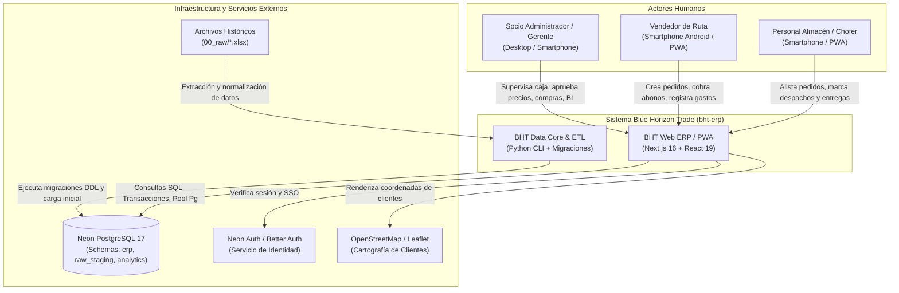
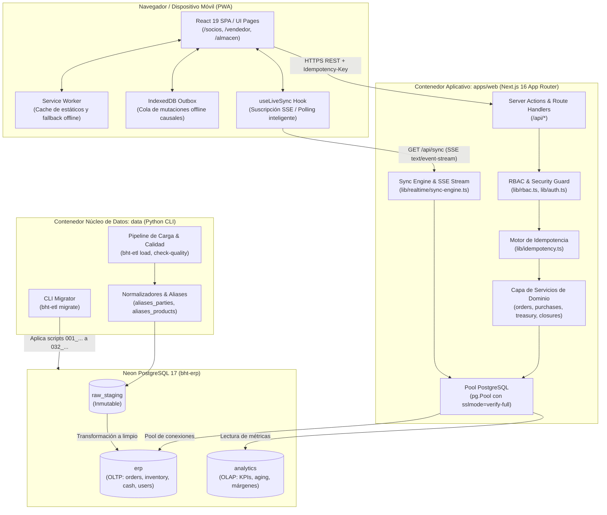
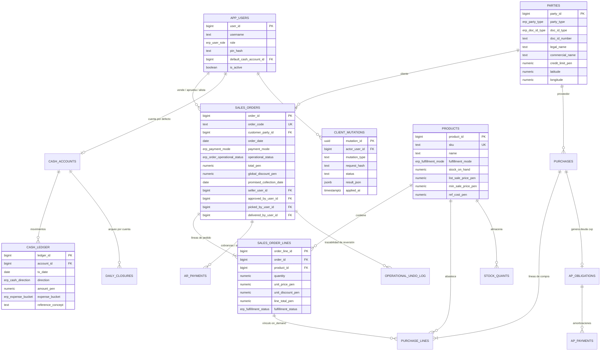
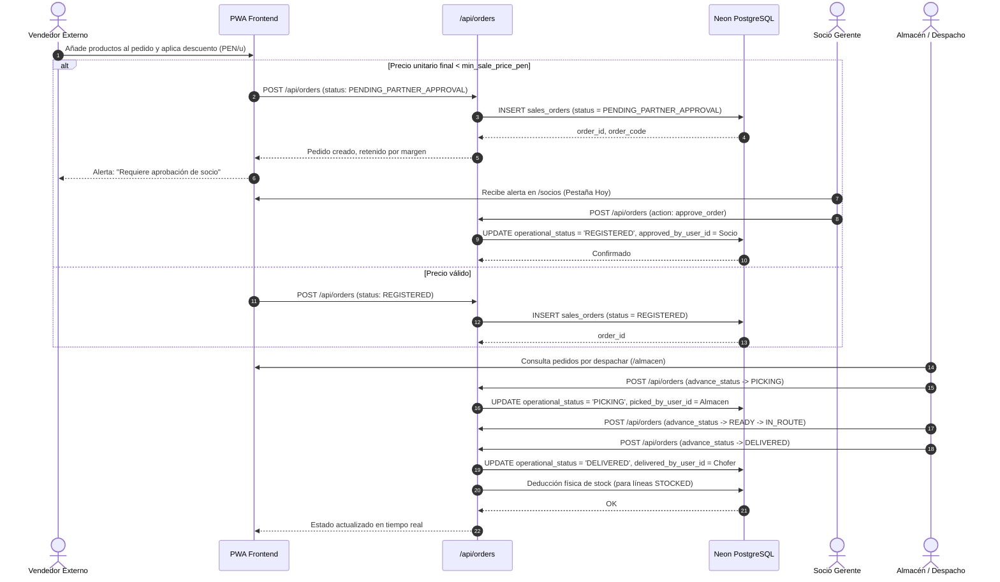
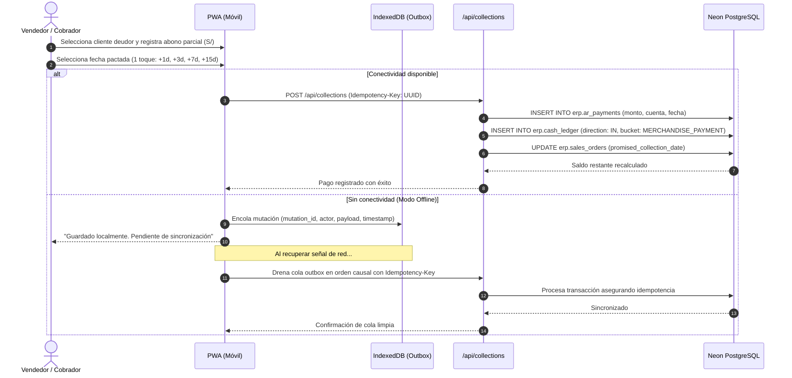
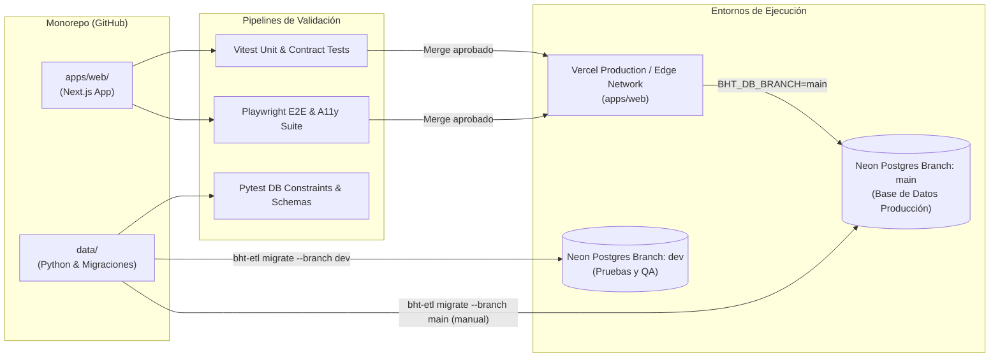

# Arquitectura Técnica del Sistema — Blue Horizon Trade ERP (`bht-erp`)

**Estándar de Documentación:** Basado en **arc42** y el **Modelo C4** (Contexto, Contenedores, Componentes y Código/Datos), con especificación conforme a directrices de arquitectura de software empresarial (IEEE 42010).

---

## 1. Introducción y Objetivos del Sistema

### 1.1. Propósito del Producto
**Blue Horizon Trade ERP** es una plataforma integral orientada a la gestión operativa, comercial, logística, de compras a proveedores, cobranzas, tesorería y analítica de negocios (BI) para **Blue Horizon Trade S.A.C.**, empresa importadora y distribuidora de autopartes (calipers, pastillas de freno, kits y repuestos) en el Perú (Lima, Huánuco y rutas regionales).

El sistema digitaliza y coordina el ciclo completo de la empresa:
$$\text{Cotización} \longrightarrow \text{Pedido} \longrightarrow \text{Aprobación} \longrightarrow \text{Alistamiento} \longrightarrow \text{Ruta/Entrega} \longrightarrow \text{Cobranza} \longrightarrow \text{Conciliación}$$

### 1.2. Usuarios y Roles del Sistema
El sistema implementa una política estricta de aislamiento de información (**Server-Side RBAC**):

| Rol | Identificador | Contexto de Uso | Nivel de Acceso y Visibilidad |
| :--- | :--- | :--- | :--- |
| **Socio Operativo / Administrador** | `PARTNER_ADMIN` | Escritorio y Móvil | Control total del sistema: márgenes reales, costos de adquisición, gestión de usuarios/accesos, anulaciones/deshacer, cierres diarios de caja y parametrización. |
| **Socio Gerente** | `PARTNER_MANAGER` | Móvil (Torre de control) / PC | Aprobación de descuentos en 1 toque, monitor de pedidos, compras a proveedores, analítica BI y exportación de reportes. |
| **Vendedor Externo** | `EXTERNAL_SELLER` | Móvil en ruta (10h/día) | Catálogo con precios de lista y piso mínimo, toma de pedidos, cotizaciones, cobranzas (abonos) y gastos de ruta. **Nunca recibe costos de compra ni márgenes brutos.** |
| **Almacén y Reparto** | `WAREHOUSE_DELIVERY` | Móvil en almacén y camión | Cola operativa de alistamiento (`PICKING`), despacho (`READY`), transporte (`IN_ROUTE`) y confirmación de entrega (`DELIVERED`). **Nunca recibe precios, descuentos, totales ni deudas.** |

### 1.3. Objetivos de Calidad Arquitectónica
1. **Resiliencia Offline y Operación Móvil de Campo:** Capacidad de operar en zonas con conectividad intermitente (rutas provinciales) mediante PWA, cola local indexada (IndexedDB), idempotencia con `Idempotency-Key` y preservación de causalidad.
2. **Barrera Financiera Inviolable:** La confidencialidad de costos y márgenes se garantiza a nivel de consultas SQL y proyecciones en servidor; ningún dato financiero sensible viaja en el payload hacia clientes no autorizados.
3. **Integridad Transaccional y Contable:** Cero inconsistencias en saldos de cuentas de caja, reglas de bloqueo por fecha de cierre contable (`fn_guard_closed_daily_period`) y doble control en deducción de inventario (`STOCKED` vs `ON_DEMAND`).

---

## 2. Restricciones Técnicas y de Entorno

- **Moneda Base:** Soles peruanos (`PEN`, `S/`).
- **Zona Horaria del Negocio:** `America/Lima` (UTC-5), obligatoria en toda la lógica de negocio, antigüedad de deudas y cierres diarios.
- **Motor de Base de Datos:** **Neon PostgreSQL 17** (Arquitectura Serverless con almacenamiento desacoplado y ramificación `main` y `dev`).
- **Backend / Frontend:** **Next.js 16 (App Router)** con React 19, TypeScript estricto, Node.js runtime y Tailwind CSS 4.
- **Núcleo de Datos y ETL:** **Python 3.9+** con `uv`, `psycopg3`, `openpyxl` y suite de migraciones SQL nativas versionadas en `public.schema_migrations`.
- **Estrategia PWA:** Service Worker propio con precache dinámico, fallback offline y compatibilidad con pantallas móviles táctiles (mínimo 44px de target).

---

## 3. Alcance y Contexto del Sistema (C4 — Nivel 1)

El siguiente diagrama ilustra la interacción de los diferentes actores y sistemas externos con el ecosistema de **bht-erp**:



---

## 4. Estructura de Contenedores (C4 — Nivel 2)

El repositorio monorepo `bht-erp` se divide en dos proyectos acoplados a través de la base de datos común de Neon:



---

## 5. Arquitectura de Componentes y Modularización (C4 — Nivel 3)

### 5.1. Módulo Web y Backend (`apps/web`)

El código fuente en `apps/web/src` se organiza mediante una arquitectura modular orientada a dominios y capacidades:

```
apps/web/src/
├── app/                           # Next.js App Router (Páginas y Endpoints API)
│   ├── (vistas)/                  # Rutas principales según rol:
│   │   ├── socios/                # Pestañas: Hoy, Ventas, Cobranzas, Inventario, Compras/CxP, Caja, Accesos
│   │   ├── vendedor/              # Catálogo, Carrito progresivo, Deudores, Gastos de ruta
│   │   └── almacen/               # Tableros Kanban de alistamiento y despacho
│   ├── api/                       # API Route Handlers REST:
│   │   ├── auth/                  # Endpoints de Neon Auth (@neon/auth) y sesión ERP
│   │   ├── sync/                  # Long-polling y Server-Sent Events (SSE)
│   │   ├── orders/                # Creación, aprobación, cambio de estado de pedidos
│   │   ├── purchases/             # Registro de compras, alta de proveedores, amortizaciones CxP
│   │   ├── collections/           # Registro de abonos, promesas de fecha de cobro
│   │   ├── treasury/              # Egresos OpEx de ruta, transferencias y depósitos
│   │   ├── daily-closures/        # Arqueo de caja y cierre diario de operaciones
│   │   ├── undo/                  # Reversión operativa segura (ventana de 24h)
│   │   └── reports/               # Descargas de reportes en CSV (UTF-8 BOM) y Excel
│   └── layout.tsx, manifest.ts   # Configuración PWA, Viewport y Theme Color
├── features/                      # Lógica de presentación, componentes y hooks por rol:
│   ├── partners/                  # Vista Socios y sus componentes bajo features/partners/components/
│   ├── seller/                    # Hooks: useSellerOrderFlow, order-draft-reducer (Offline draft)
│   └── warehouse/                 # Hooks: useWarehouseData, useWarehouseActions
├── components/                    # Componentes UI reutilizables:
│   ├── directory/                 # Gestión de Clientes, Proveedores y Mapas Leaflet
│   ├── pwa/                       # PwaRuntime, OfflineQueuePanel
│   ├── shared/                    # Controles transversales (CollectionControls, RecentUndoStrip)
│   └── ui/                        # Primitivas de diseño: AppShell, ResponsiveDataTable, etc.
└── lib/                           # Infraestructura de dominio y utilitarios:
    ├── db.ts                      # Gestión de Pool PostgreSQL singleton y normalización de SSL
    ├── auth.ts / rbac.ts          # Resolución de actores vía Neon Auth y proyecciones RBAC
    ├── idempotency.ts             # Decorador runIdempotentMutation y hash SHA-256
    ├── realtime/sync-engine.ts    # Motor de sincronización incremental basado en marcas de tiempo
    ├── offline/outbox.ts          # Cola de operaciones en cliente con orden causal
    └── services/                  # Capa de lógica de negocio pura (Transacciones y SQL)
```

### 5.2. Módulo de Datos y Migraciones (`data`)

Diseñado con el principio de **Idempotencia y Preservación de Auditoría**:

- `src/bht_etl/extractors/`: Lee libros de cálculo Excel (`.xlsx`) respetando estructuras históricas de ventas, compras, caja y stock inicial.
- `src/bht_etl/normalize.py`: Estandariza descripciones de artículos y nombres de entidades eliminando acentos, espacios duplicados y caracteres especiales.
- `config/aliases_products.csv`: Diccionario que mapea descripciones operativas de campo hacia el código SKU oficial y su factor de empaque (`pack_factor`).
- `config/aliases_parties.csv`: Diccionario de normalización de clientes y proveedores a partir de RUC/DNI o razón social canónica.
- `db/migrations/`: Colección secuencial (001 a 032) de scripts DDL/DML aplicados en orden estricto con comprobación de checksum SHA-256 en `public.schema_migrations`.

---

## 6. Arquitectura de Datos (C4 — Nivel 4)

El almacenamiento en Neon PostgreSQL está particionado conceptualmente en tres esquemas:



### 6.1. Reglas Críticas Integradas en la Base de Datos

1. **Protección de Periodo Contable Cerrado (`fn_guard_closed_daily_period`):**
   - Disparador en `cash_ledger`, `ar_payments`, `sales_orders` y `purchases`.
   - Impide cualquier inserción, modificación o eliminación sobre fechas donde ya exista un `daily_closure` aprobado, protegiendo la inmutabilidad histórica.
2. **Diferenciación `STOCKED` vs `ON_DEMAND`:**
   - Los productos con `fulfillment_mode = 'STOCKED'` validan existencia física en el almacén `MAIN`.
   - Los productos `ON_DEMAND` registran sus líneas como `PENDING_SUPPLIER_PURCHASE` sin descontar inventario preventivo, activando una alerta en el panel de Socios.
3. **Resolución Automática de `ON_DEMAND` en Compras:**
   - Al registrar una compra en `erp.purchases`, el socio puede vincular las líneas de pedidos pendientes (`fulfillOrderLineIds`), actualizando atómicamente el estado de la línea a `FULFILLED` y vinculando el lote de compra.
4. **Idempotencia de Mutaciones de Cliente (`erp.client_mutations`):**
   - Toda llamada con encabezado `Idempotency-Key: <UUID>` inserta una reserva atómica con el hash SHA-256 del payload. Si la clave ya fue procesada, retorna el resultado cacheado (`result_json`) sin reejecutar la transacción.

---

## 7. Flujos de Procesos Clave (Diagramas de Secuencia)

### 7.1. Flujo de Pedido, Control de Precio Piso y Progresión Logística



### 7.2. Flujo de Cobranza en Ruta y Gestión de Créditos



---

## 8. Arquitectura de Seguridad y RBAC

### 8.1. Matriz de Proyecciones de Datos en Servidor (`lib/rbac.ts`)

Para evitar fugas de información, los métodos `projectProductForRole` y `projectOrderForRole` sanitizan los objetos devueltos antes de transmitirlos por HTTP:

| Campo / Entidad | `PARTNER_ADMIN` | `PARTNER_MANAGER` | `EXTERNAL_SELLER` | `WAREHOUSE_DELIVERY` |
| :--- | :---: | :---: | :---: | :---: |
| **Código SKU, Nombre, Unidad** | Visible | Visible | Visible | Visible |
| **Stock Físico en Mano** | Visible | Visible | Visible | Visible |
| **Precio de Lista y Precio Piso** | Visible | Visible | Visible | **Oculto (`null`)** |
| **Costo Referencial de Compra (`ref_cost_pen`)** | Visible | Visible | **Oculto (`null`)** | **Oculto (`null`)** |
| **Margen Bruto de Línea / Total** | Visible | Visible | **Oculto (`null`)** | **Oculto (`null`)** |
| **Proveedor por Defecto** | Visible | Visible | **Oculto (`null`)** | **Oculto (`null`)** |
| **Totales de Deuda y Estado de Pago** | Visible | Visible | Visible | **Oculto (`null`)** |
| **Gestión de Accesos y Usuarios** | Visible | **Oculto** | **Oculto** | **Oculto** |

### 8.2. Esquema de Autenticación
1. **Neon Auth (`@neon/auth`):** Toda la autenticación de usuarios en producción y desarrollo se realiza mediante Neon Auth (protegido por `apps/web/proxy.ts` y resuelto en `apps/web/src/lib/auth.ts`).
2. **Vinculación a Rol ERP:** El sistema exige correo verificado en la sesión de Neon Auth y lo asocia en `erp.app_users` (vinculando atómicamente `neon_auth_user_id` en el primer ingreso cuando es `NULL` y validando `is_active = TRUE`). La activación, alta y asignación de roles corresponde exclusivamente a `PARTNER_ADMIN`.

---

## 9. Sincronización en Tiempo Real y Estado Híbrido

El sistema implementa una arquitectura híbrida de actualización en tiempo real:

1. **Protocolo SSE (`/api/sync?stream=1`):**
   - Conexión Server-Sent Events de larga duración (hasta 55s por ciclo para compatibilidad serverless).
   - El cliente envía una marca temporal o versión (`since`).
   - El servidor evalúa las tablas relevantes según el rol del actor (`PARTNER_SCOPES`, `SELLER_SCOPES`, `WAREHOUSE_SCOPES`) y envía eventos únicamente si hubo mutaciones recientes.
2. **Preparación Neon Realtime:**
   - La arquitectura incluye adaptadores en `lib/realtime/sync-engine.ts` preparados para activar `@neon/realtime` mediante réplica lógica de PostgreSQL sin alterar el contrato del cliente.
3. **TanStack React Query:**
   - Mantiene la caché en memoria del cliente con claves separadas por rol y filtros de búsqueda, invalidándose selectivamente ante eventos del SSE o confirmaciones locales.

---

## 10. Despliegue, Infraestructura y Ciclo de Vida



### 10.1. Gestión de Ambientes y Ramas en Neon
- **`dev` (Branch de desarrollo):** Utilizado por las pruebas unitarias y de integración (`npm test` / `pytest`), así como para verificar migraciones destructivas antes de tocar producción.
- **`main` (Branch de producción):** Almacena las operaciones vivas del negocio. Las migraciones solo se aplican mediante ejecución explícita del comando CLI `uv run bht-etl migrate --branch main` tras comprobar los checksums de `public.schema_migrations`.

---

## 11. Resumen de Tecnologías y Estándares Empleados

| Componente | Tecnología / Librería | Versión | Justificación Técnica |
| :--- | :--- | :--- | :--- |
| **Framework Web** | Next.js (App Router) | `16.4.6` | Renderizado híbrido, Server Actions, Route Handlers y empaquetado optimizado. |
| **Librería de UI** | React / React-DOM | `19.3.1` | Concurrent rendering, Server Components y hooks modernos. |
| **Gestor de Datos UI** | TanStack React Query | `5.108.2` | Caché cliente, revalidación en segundo plano y manejo de estados asíncronos. |
| **Cartografía** | Leaflet | `1.9.4` | Georreferenciación de clientes en ruta sin costo recurrente de APIs de mapas. |
| **Cliente Base de Datos** | `pg` (node-postgres) | `8.13.1` | Pool transaccional directo de alta velocidad con soporte de tipos custom de Postgres. |
| **Validación de Schemas**| Zod | `4.6.7` | Validación estricta en tiempo de ejecución para todos los payloads de mutaciones. |
| **Pruebas Unitarias/API**| Vitest | `4.1.12` | Ejecución ultrarrápida de suites de prueba TypeScript sin transpilar a mano. |
| **Pruebas E2E / A11y** | Playwright + Axe-Core | `1.65.1` | Automatización de flujos completos y verificación de accesibilidad WCAG 2.1 AA. |
| **Núcleo ETL** | Python + psycopg3 + uv | `>=3.9` | Carga de datos de alto rendimiento, normalización de cadenas y control de esquemas. |
